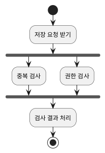

# UML 활동 다이어그램

- 실행 단계를 활동으로 정리한다. 판단과 병합에는 마름모를, 여러 경로를 함께 시작하거나 기다리는 분기와 합류에는 fork·join 막대를 쓴다.
- 병렬 작업을 나란히 놓고 합류 뒤에 공통 후속 작업을 둔다. 모든 경로가 완료되어야 진행하는지, 다른 조건이 있는지 확인한다. 일부 경로만 기다리는 동작에 기본 join을 쓰면 실제 동작과 달라지므로 진행 조건을 표현할 수 있는 표기를 선택한다.
- PlantUML에서는 `fork`와 `fork again`으로 시작한 병렬 경로를 `end fork`로 합친다. 아래 예시는 두 검사가 모두 끝난 뒤 결과를 처리하는 경우다.

- 검증할 때 실제로 동시에 시작할 수 있는 작업인지, 합류가 기다리는 경로가 맞는지 확인한다. 조건 분기나 중단으로 필요한 입력이 합류점에 도착하지 않을 수 있다면 해당 경로의 처리 방식을 확인한다.

[PlantUML 활동 다이어그램 문법](https://plantuml.com/activity-diagram-beta)
