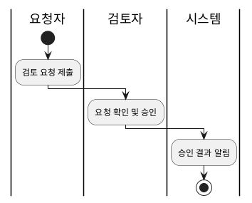

# 스윔레인

- 역할·팀·시스템 등 책임을 나누는 기준 하나로 레인을 구성한다. 각 작업을 수행 주체의 레인에 넣고, 책임이 넘어가는 지점에서 레인을 가로질러 연결한다.
- 후속 담당자가 작업을 시작하는 데 필요한 입력이 핵심이면 `승인 요청`, `보완 자료`처럼 실제로 인계하는 항목을 표시한다. 대기나 승인처럼 책임이 중요한 단계는 그 작업을 맡는 레인 안에 둔다.
- PlantUML 활동 문법의 `|레인 이름|`으로 레인을 선택할 수 있다. 병렬 실행도 필요하면 [활동 다이어그램 규칙](activity.md)을 함께 적용한다.

- 검증할 때 각 작업의 수행 주체와 레인이 일치하는지, 레인을 가로지르는 화살표가 실제 인계를 나타내는지 확인한다. 승인 결과가 돌아오거나 요청이 반려되는 경로도 범위 안이면 해당 담당자까지 연결한다.

[PlantUML 스윔레인 문법](https://plantuml.com/activity-diagram-beta#swimlanes)
